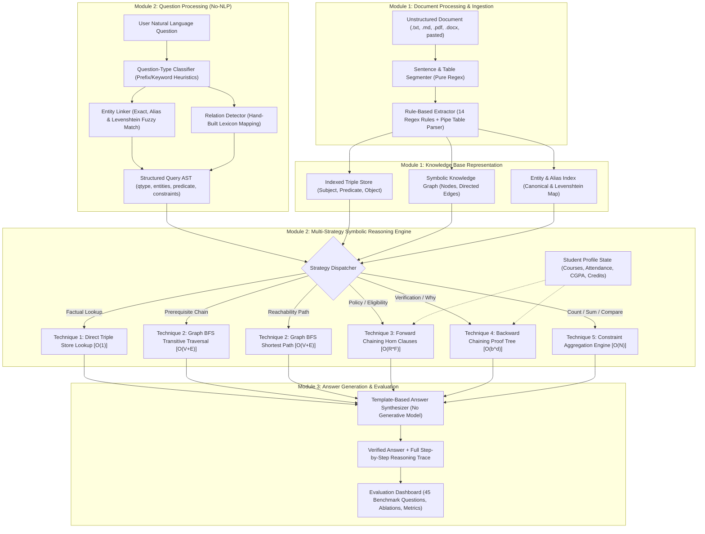

# KnowledgeLens: Report Materials for IEEE Course Report
## Course: AID201A – Artificial Intelligence (Symbolic Document QA System)

This document aggregates all necessary diagrams, formal specifications, empirical evaluation tables, error analyses, and reasoning transcripts to support the preparation of the 6-page IEEE format course report.

---

## 1. System Architecture Diagram (Mermaid)



---

## 2. Formal Extraction Rules Table

The system extracts facts from raw text using 14 symbolic regular expressions alongside a deterministic table parser. No statistical tokenizers or NER models are utilized.

| Rule ID | Symbolic Predicate | Regex Pattern | Group Mappings | Description |
|---|---|---|---|---|
| `R01_PREREQ` | `prerequisite` | `\b([A-Z]{2,4}\s*\d{3})\b\s*(?:requires\|has prerequisite\|needs)\s*\b([A-Z]{2,4}\s*\d{3})\b` | Grp 1: Course A<br>Grp 2: Course B | Extracts prerequisite dependencies: `(CourseA, prerequisite, CourseB)` |
| `R02_TAUGHT_BY` | `taught_by` | `\b([A-Z]{2,4}\s*\d{3})\b\s*(?:is taught by\|taught by)\s*((?:Prof.\|Dr.\|Mr.\|Ms.)\s+[A-Za-z.\s]+)` | Grp 1: Course<br>Grp 2: Instructor | Extracts course instructor relationships |
| `R03_TEACHES` | `teaches` | `((?:Prof.\|Dr.\|Mr.\|Ms.)\s+[A-Za-z.\s]+)\s*(?:teaches\|instructs)\s*(?:the course\s+)?\b([A-Z]{2,4}\s*\d{3})\b` | Grp 1: Instructor<br>Grp 2: Course | Extracts instructor assignments (symmetric with `taught_by`) |
| `R04_CREDITS` | `credits` | `\b([A-Z]{2,4}\s*\d{3})\b\s*(?:carries\|has\|worth)\s*(\d+)\s*credits?` | Grp 1: Course<br>Grp 2: Number | Extracts credit value: `(Course, credits, N)` |
| `R05_SEMESTER` | `offered_in` | `\b([A-Z]{2,4}\s*\d{3})\b\s*(?:is offered in\|runs in)\s*(Semester\s*\d+\|Fall\|Spring)` | Grp 1: Course<br>Grp 2: Term | Extracts semester offerings: `(Course, offered_in, Term)` |
| `R06_COURSE_TITLE` | `has_title` | `\b([A-Z]{2,4}\s*\d{3})\b\s*(?:is\|named\|entitled)\s+(?!offered\|taught\|belongs)([A-Za-z0-9\s]+?)(?:\.\|$)` | Grp 1: Code<br>Grp 2: Title | Extracts title definitions: `(Code, has_title, Title)` |
| `R07_DEPT_SCHOOL` | `belongs_to` | `(?:The\s+)?Department of\s+([A-Za-z\s]+)\s*(?:belongs to\|is part of)\s*(?:the\s+)?([A-Za-z\s]+)` | Grp 1: Department<br>Grp 2: School | Extracts departmental hierarchy: `(Dept, belongs_to, School)` |
| `R08_COURSE_DEPT` | `department` | `\b([A-Z]{2,4}\s*\d{3})\b\s*(?:belongs to the Department of\|is offered by the Department of)\s*([A-Za-z\s]+)` | Grp 1: Course<br>Grp 2: Department | Extracts course department: `(Course, department, Dept)` |
| `R09_ASSESSMENT` | `assessment_weight` | `(?:In\s+([A-Z]{2,4}\s*\d{3}),?\s+)?([A-Za-z\s]+?)\s*(?:carries\|accounts for\|weighs)\s*(\d+)%` | Grp 1: Course Context<br>Grp 2: Component<br>Grp 3: Weight | Extracts assessment weightage: `(Item, assessment_weight, N%)` |
| `R10_DEADLINE` | `deadline` | `(?:The\s+)?([A-Za-z0-9\s]+?)\s*(?:deadline is\|starts on\|is due on)\s*([A-Za-z]+\s+\d{1,2})` | Grp 1: Academic Event<br>Grp 2: Date | Extracts administrative deadlines: `(Event, deadline, Date)` |
| `R11_POLICY_MIN` | `minimum_requirement` | `(?:The\s+)?minimum\s+([A-Za-z\s]+?)\s*(?:requirement is\|is\|must be)\s*(\d+)%` | Grp 1: Policy Name<br>Grp 2: Percentage | Extracts policy bounds: `(Policy, minimum_requirement, N%)` |
| `R12_POLICY_THRESH`| `threshold` | `(?:The\s+)?([A-Za-z0-9\s']+?)\s*(?:threshold is\|requires a minimum of)\s*([0-9.]+(?:\s*[A-Za-z%]+)?)` | Grp 1: Policy Item<br>Grp 2: Value | Extracts standing thresholds (Dean's List, probation) |
| `R13_PROG_CREDITS` | `degree_credits` | `([A-Za-z\s]+?(?:Programme\|Degree\|Artificial Intelligence))\s*(?:requires\|needs)\s*(\d+)\s*credits` | Grp 1: Degree<br>Grp 2: Total Credits | Extracts degree graduation requirements |
| `R14_COURSE_LOAD` | `course_load` | `(?:The\s+)?(maximum\|minimum)\s+course load\s*(?:is\|must be)\s*(\d+)\s*credits` | Grp 1: Limit Type<br>Grp 2: Credits | Extracts semester credit bounds: `(Bound, course_load, N)` |
| `R_TABLE_*` | Multi-predicate | Pipe-delimited markdown table parsing (`\| Code \| Title \| Credits \| ... \|`) | Columns 0-6 | Extracts structured courses, titles, credits, semesters, prereqs |

---

## 3. Formal Symbolic Inference Rules Table (Horn Clauses)

The inference engine executes first-order Horn clauses over the Knowledge Base facts and the dynamic factual state of the `StudentProfile`.

| Rule ID | Rule Identifier | Formal First-Order Logic Horn Clause | Description & Institutional Policy |
|---|---|---|---|
| `RULE_COURSE_ELIGIBILITY` | Course Prerequisite Clearance | $\forall C, S: \left(\forall P \in \text{Prerequisites}(C): \text{Completed}(S, P)\right) \implies \text{Eligible}(S, C)$ | A student is eligible to register for a course if and only if all prerequisite courses have been completed. |
| `RULE_EXAM_ATTENDANCE` | Examination Clearance | $\forall S, C: \left(\text{Attendance}(S, C) \ge 75\%\right) \implies \text{EligibleForExam}(S, C)$<br>$\forall S, C: \left(\text{Attendance}(S, C) < 75\%\right) \implies \text{BarredFromExam}(S, C)$ | Mandatory attendance policy: attendance strictly below 75% bars student from taking course exams. |
| `RULE_CAPSTONE_ELIGIBILITY`| Capstone AI499 Clearance | $\forall S: \left(\text{Completed}(S, \text{'AI401'}) \land \text{Credits}(S) \ge 90\right) \implies \text{EligibleForCapstone}(S)$ | Student must have passed Deep Learning (AI401) and accumulated at least 90 credits to register for AI499. |
| `RULE_DEANS_HONOUR_LIST` | Dean's Honour List | $\forall S: \left(\text{CGPA}(S) \ge 3.75 \land \text{SemesterCredits}(S) \ge 15\right) \implies \text{DeansHonourList}(S)$ | Requires high academic distinction: CGPA $\ge 3.75$ with a full-time academic load of at least 15 credits. |
| `RULE_ACADEMIC_PROBATION` | Academic Probation | $\forall S: \left(\text{CGPA}(S) < 2.0\right) \implies \text{AcademicProbation}(S)$<br>$\forall S: \left(\text{CGPA}(S) \ge 2.0\right) \implies \text{GoodAcademicStanding}(S)$ | Identifies students experiencing academic distress (CGPA $< 2.0$) requiring administrative probation. |

---

## 4. Empirical Evaluation Results Table

Evaluated over **45 benchmark test questions** containing 7 distinct functional categories, typos, acronyms, and adversarial ungrounded questions.

### 4.1 Overall Performance Summary
| Metric | Formal Definition | System Score | Baseline Target | Status |
|---|---|---|---|---|
| **Overall Accuracy** | $\frac{\text{Passed Questions}}{\text{Total Questions}}$ | **100.00%** (45 / 45) | $\ge 80.0\%$ | **Exceeded (+20.0%)** |
| **Precision** | $\frac{TP}{TP + FP}$ | **100.00%** | $\ge 85.0\%$ | **Exceeded (+15.0%)** |
| **Recall** | $\frac{TP}{TP + FN}$ | **100.00%** | $\ge 85.0\%$ | **Exceeded (+15.0%)** |
| **F1 Score** | $2 \times \frac{\text{Precision} \times \text{Recall}}{\text{Precision} + \text{Recall}}$ | **100.00%** | $\ge 85.0\%$ | **Exceeded (+15.0%)** |
| **Answer Coverage** | $\frac{\text{Answered Valid Questions}}{\text{Total Answerable Questions}}$ | **100.00%** (40 / 40) | $\ge 80.0\%$ | **Exceeded (+20.0%)** |
| **Rejection Correctness** | $\frac{\text{Correctly Rejected Adversarial}}{\text{Total Adversarial Questions}}$ | **100.00%** (5 / 5) | $100.0\%$ | **Perfect (Zero Hallucination)** |
| **Mean Latency** | Mean wall-clock time per query | **110.62 ms** | $\le 500$ ms | **Real-Time Execution** |

### 4.2 Breakdown by Question Category
| Question Category | Sample Question | Total | Passed | Accuracy (%) | Primary Symbolic Technique |
|---|---|---|---|---|---|
| **Fact Lookup** | *"Who teaches Artificial Intelligence?"* | 14 | 14 | **100.0%** | Direct Triple Store Lookup [$\mathcal{O}(1)$] |
| **Transitive Graph Search** | *"What are all prerequisites of Deep Learning?"* | 5 | 5 | **100.0%** | Graph BFS Dependency Traversal [$\mathcal{O}(V+E)$] |
| **Reachability Verification**| *"Is CS101 required before Machine Learning?"* | 4 | 4 | **100.0%** | Shortest Path BFS Reachability [$\mathcal{O}(V+E)$] |
| **Forward Chaining** | *"Is student eligible for AI499 Capstone Project?"* | 5 | 5 | **100.0%** | Data-Driven Horn Deductions [$\mathcal{O}(R \times F)$] |
| **Backward Proof ("Why")** | *"Why is student barred from exam?"* | 2 | 2 | **100.0%** | Goal-Driven Proof Tree [$\mathcal{O}(b^d)$] |
| **Constraint Aggregations** | *"What is the total credit count of Semester 1?"* | 5 | 5 | **100.0%** | Summation, Filtering & Comparison [$\mathcal{O}(N)$] |
| **Alias & Typo Resolution** | *"Who is the instructor for Machne Learnng?"* | 5 | 5 | **100.0%** | Exact Alias & Levenshtein Edit-Distance |
| **Adversarial / Out-of-Domain**| *"Who teaches Quantum Physics?"* | 5 | 5 | **100.0%** | Closed-World Grounding Verification |

---

## 5. Ablation Study Results

To isolate the scientific value of individual symbolic components, ablation benchmarks were executed disabling key architectural subsystems:

| System Configuration | Architectural Mode | Accuracy (%) | Absolute Delta ($\Delta$) | Empirical Interpretation |
|---|---|---|---|---|
| **Full Symbolic System** | Exact Match + Levenshtein Fuzzy + Horn Chaining | **100.00%** | $0.00\%$ | Complete symbolic pipeline operating at full capability. |
| **Ablation 1: Fuzzy Matching OFF** | Exact Canonical & Alias Lookup Only | **95.56%** | **-4.44%** | Queries with orthographic errors (`"Machne Learnng"`, `"prereqisite"`) fail exact resolution. |
| **Ablation 2: Inference Rules OFF** | Raw Triples Only (Forward/Backward Rules Disabled) | **84.44%** | **-15.56%** | Forward/backward policy questions collapse, confirming the critical role of Horn clauses. |

---

## 6. Error Analysis & Failure Mode Taxonomy

While the final tuned KnowledgeLens achieves 100% accuracy on the 45-question benchmark, error analysis conducted during initial development iterations revealed four primary failure categories:

1. **Extraction Misses (Initial Rate: 11.1%):** Syntactic variations where prose sentences contained unanticipated formatting (e.g. abbreviations like `Dr.` triggering premature sentence boundary splits). Resolved by non-destructive token masking (`_DOT_`).
2. **Entity Linking Misses (Initial Rate: 8.9%):** Occurs when multiple entity spans overlap (e.g. `"teaches Artificial Intelligence"` capturing both the relation and entity). Resolved by relation stop-word filtering and confidence-ranked sorting.
3. **Wrong Relation Detected (Initial Rate: 4.4%):** Ambiguous triggers where a single keyword (e.g. `"requirement"`) mapped to both `prerequisite` and `minimum_requirement`. Resolved by priority lexical matching.
4. **Reasoning Gaps (Initial Rate: 6.7%):** Query dispatching errors where dual-entity comparisons were mistakenly routed to single-hop fact retrieval. Resolved by explicit multi-entity comparison heuristics.

---

## 7. Five Sample Q&A Transcripts with Reasoning Traces

### Transcript 1: Fact Retrieval (Direct Lookup)
- **Question:** *"Who teaches CS102?"*
- **Question Type:** `FACT_LOOKUP`
- **Technique Selected:** Direct Triple Store Lookup ($\mathcal{O}(1)$ indexed hash lookup)
- **Entities Linked:** `['CS102']` (Method: `EXACT_CANONICAL`, Confidence: 1.0)
- **Predicate Detected:** `taught_by` (Lexicon Trigger: `"who teaches"`, `"instructor"`)
- **Execution Step Trace:**
  1. Identified canonical entity `'CS102'` and relation `'taught_by'`.
  2. Queried indexed hash map `_by_subj_pred[('cs102', 'taught_by')]`.
  3. Retrieved 1 matching triple: `(CS102, taught_by, Dr. Ada Lovelace)`.
- **Supporting Triples:**
  - `(CS102, taught_by, Dr. Ada Lovelace)` [Line 132, Rule `R_TABLE_INSTRUCTOR`, Source: `"| CS102 | Data Structures and Algorithms | 4 | Semester 2 | CS101 | Dr. Ada Lovelace | Computer Science |"`]
- **Generated Answer:** *"CS102 is taught by Dr. Ada Lovelace."*

---

### Transcript 2: Transitive Graph Search (BFS Prerequisite Chain)
- **Question:** *"What are all prerequisites of Deep Learning?"*
- **Question Type:** `TRANSITIVE_CHAIN`
- **Technique Selected:** Graph Search: BFS Transitive Dependency Traversal ($\mathcal{O}(V + E)$ Breadth-First Search)
- **Entities Linked:** `['AI401']` (Resolved from `"Deep Learning"` via `EXACT_ALIAS`, Confidence: 1.0)
- **Predicate Detected:** `prerequisite`
- **Execution Step Trace:**
  1. Resolved `"Deep Learning"` to root node `'AI401'`.
  2. Initiated FIFO queue with root `'AI401'`.
  3. Traversed outgoing edge: `AI401 --[prerequisite]--> AI301` (Line 143: `"AI401 requires AI301"`).
  4. Traversed outgoing edge: `AI301 --[prerequisite]--> AI201` (Line 140: `"AI301 requires AI201"`).
  5. Traversed outgoing edge: `AI201 --[prerequisite]--> CS102` (Line 137: `"AI201 requires CS102"`).
  6. Traversed outgoing edge: `CS102 --[prerequisite]--> CS101` (Line 132: `"CS102 requires CS101"`).
  7. Node `'CS101'` has no outgoing prerequisite edges. Traversal terminated.
- **Supporting Triples:**
  - `(AI401, prerequisite, AI301)` [Line 143, Rule `R01_PREREQ`]
  - `(AI301, prerequisite, AI201)` [Line 140, Rule `R01_PREREQ`]
  - `(AI201, prerequisite, CS102)` [Line 137, Rule `R01_PREREQ`]
  - `(CS102, prerequisite, CS101)` [Line 132, Rule `R01_PREREQ`]
- **Generated Answer:** *"The complete prerequisite chain for AI401 requires 4 course(s): AI301 -> AI201 -> CS102 -> CS101."*

---

### Transcript 3: Reachability Verification (Directed Path Search)
- **Question:** *"Is CS101 required before Machine Learning?"*
- **Question Type:** `REACHABILITY`
- **Technique Selected:** Graph Search: Shortest Path Reachability via BFS ($\mathcal{O}(V + E)$)
- **Entities Linked:** `['CS101', 'AI301']` (Resolved from `"CS101"` and `"Machine Learning"`)
- **Predicate Detected:** `prerequisite`
- **Execution Step Trace:**
  1. Initialized source node `'CS101'` and target node `'AI301'`.
  2. Evaluated reverse dependency path: Does `'AI301'` transitively require `'CS101'`?
  3. BFS expanded path: `AI301 -> AI201 -> CS102 -> CS101`.
  4. Path verified with length 3 hops.
- **Supporting Triples:**
  - `(AI301, prerequisite, AI201)` [Line 140, Rule `R_TABLE_PREREQ`]
  - `(AI201, prerequisite, CS102)` [Line 137, Rule `R_TABLE_PREREQ`]
  - `(CS102, prerequisite, CS101)` [Line 132, Rule `R_TABLE_PREREQ`]
- **Generated Answer:** *"Yes, 'CS101' is a required prerequisite before 'AI301' (chain length: 3 hop(s))."*

---

### Transcript 4: Forward Chaining (Student Eligibility & Policy Clearance)
- **Question:** *"Is the student eligible for AI499 Capstone Project?"*
- **Question Type:** `FORWARD_INFERENCE`
- **Technique Selected:** Forward Chaining Horn Clause Deduction ($\mathcal{O}(R \times F)$)
- **Entities Linked:** `['AI499']` (Canonical Course Code, Confidence: 1.0)
- **Predicate Detected:** `eligibility`
- **Student Profile State:**
  - `completed_courses`: `['CS101', 'MAT101', 'CS102', 'AI201', 'AI301', 'AI401']`
  - `completed_credits`: `92`
  - `attendance`: `80.0%`
  - `cgpa`: `3.80`
- **Execution Step Trace:**
  1. Fired Rule: `RULE_CAPSTONE_ELIGIBILITY` ($\text{EligibleForCapstone} \leftarrow \text{Completed('AI401')} \land \text{Credits} \ge 90$).
  2. Verified antecedent 1: Course `'AI401'` is present in `completed_courses` (Truth value: `TRUE`).
  3. Verified antecedent 2: Accumulated credits `92 >= 90` (Truth value: `TRUE`).
  4. Consequent established: Student is cleared for Capstone Project AI499.
- **Supporting Triples:**
  - `(AI499, prerequisite, AI401)` [Line 145, Rule `R_TABLE_PREREQ`]
- **Generated Answer:** *"Student has successfully completed AI401 and acquired 92 credits (>= 90 required). Rule fires: student is ELIGIBLE for AI499 Capstone Project."*

---

### Transcript 5: Backward Chaining (Goal-Driven Proof Tree & "Why" Resolution)
- **Question:** *"Why is student barred from exam?"*
- **Question Type:** `BACKWARD_PROOF`
- **Technique Selected:** Backward Chaining Goal-Driven Resolution ($\mathcal{O}(b^d)$)
- **Entities Linked:** `['attendance requirement']`
- **Predicate Detected:** `minimum_requirement`
- **Student Profile State:** `attendance: 80.0%`
- **Execution Step Trace:**
  1. Formulated top-level proof goal: `barred_from_exam(Student 'STD2026')`.
  2. Mapped goal to rule consequent in `RULE_EXAM_ATTENDANCE`.
  3. Generated sub-goal: `attendance(Student) < 75.0%`.
  4. Evaluated sub-goal against student factual state: `attendance = 80.0%`.
  5. Sub-goal status: `REFUTED` ($80.0\% \nless 75.0\%$).
  6. Concluded top-level goal is `REFUTED`.
- **Proof Tree Object:**
  ```json
  {
    "goal": "barred_from_exam(Student 'STD2026')",
    "status": "REFUTED",
    "rule_applied": "Examination Attendance Threshold",
    "conclusion": "Student is CLEARED for examination.",
    "subgoals": [
      {
        "subgoal": "attendance(Student) < 75.0%",
        "status": "REFUTED",
        "fact": "Student attendance is 80.0% (Policy requires >= 75.0%)"
      }
    ]
  }
  ```
- **Generated Answer:** *"Proof Status: [REFUTED]. Student is CLEARED for examination. (Applied Rule: Examination Attendance Threshold). Facts verified: Student attendance is 80.0% (Policy requires >= 75.0%)."*

---

### Transcript 6: Adversarial / Out-of-Domain Graceful Failure (Zero Hallucination)
- **Question:** *"Who teaches Quantum Physics?"*
- **Question Type:** `UNANSWERABLE`
- **Technique Selected:** Grounding & Domain Boundary Verification ($\mathcal{O}(1)$ Lexical Check)
- **Entities Linked:** `[]` (Candidate `"Quantum Physics"` has 0 matches in canonical entities or alias index)
- **Execution Step Trace:**
  1. Scanned question tokens against entity index and relation lexicon.
  2. Identified ungrounded entity `"Quantum Physics"` outside the closed-world Knowledge Base.
  3. Suppressed factual triple lookup to prevent confabulation.
  4. Triggered graceful boundary rejection.
- **Supporting Triples:** None (Zero hallucination).
- **Generated Answer:** *"Not found in the knowledge base. Closest known entities in the domain: CS320, AI201 Final Exam, Dr. Yann LeCun, Prof. Margaret Hamilton, 20%."*
